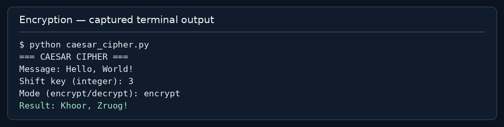
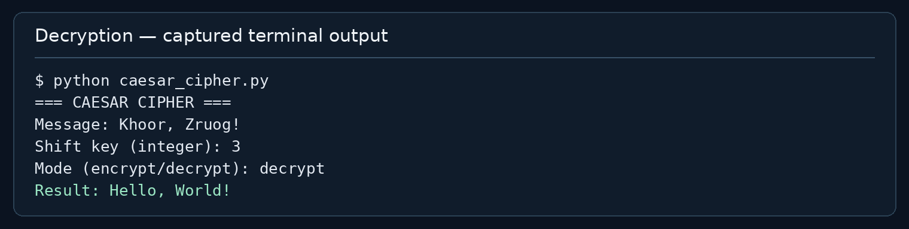
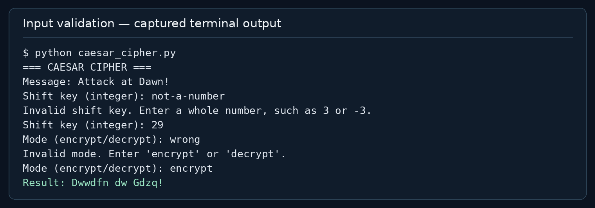
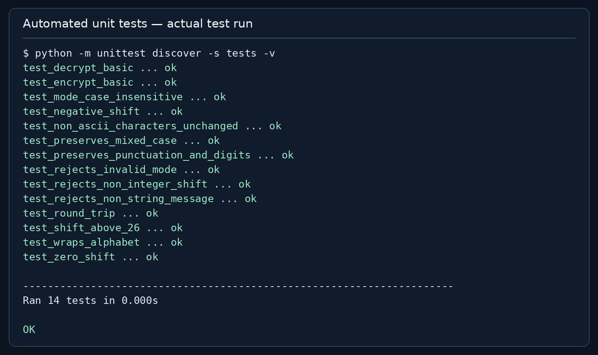

# Caesar Cipher — Technical Case Study

## Project Overview

Developed a Python application implementing the Caesar substitution cipher for text encryption and decryption. The project explores ASCII character handling, alphabet rotation, input validation, and repeatable tests.

## Technical Implementation

| Component | Implementation |
| --- | --- |
| Language | Python 3; standard library only |
| Encryption / decryption | Character-code transformation using modulo 26 |
| Letter handling | Preserves ASCII uppercase/lowercase; leaves other characters unchanged |
| Input validation | Mode selection and integer shift-key prompts |
| Automated tests | `unittest` with 14 cases |

### Cipher Logic

For each ASCII letter, the program determines its alphabet position, applies a normalized shift, and wraps the result using modulo 26. Decryption reverses the shift. Non-letter characters are appended without modification.

```python
offset = shift % 26
if mode.lower() == "decrypt":
    offset = -offset
new_position = (position + offset) % 26
```

## Verified Execution Results

| Scenario | Observed output |
| --- | --- |
| Encrypt `Hello, World!`, shift 3 | `Khoor, Zruog!` |
| Decrypt `Khoor, Zruog!`, shift 3 | `Hello, World!` |
| Encrypt `XYZ xyz`, shift 3 | `ABC abc` |
| Encrypt `HELLO`, shift 29 | `KHOOR` |
| Encrypt `Attack at Dawn!`, shift 5 | `Fyyfhp fy Ifbs!` |

### Encryption



### Decryption



## Input Handling

The program reprompts when a user enters a non-integer shift key or unsupported mode. The recorded execution demonstrates both conditions before successfully encrypting the input.



## Automated Tests

Executed `python -m unittest discover -s tests -v` against the revised program. **14 tests passed**, including case preservation, wraparound, negative and large shift values, punctuation, round-trip conversion, and invalid inputs.



## Project Outcome

Produced a working command-line encryption/decryption program, improved input handling, and a reproducible unit-test suite. The repository includes both the initial script and the updated implementation.

## Security Context

The Caesar cipher has only 25 nontrivial shifts and is not suitable for protecting sensitive information. This project demonstrates fundamental substitution-cipher mechanics and Python programming, not secure modern cryptography.
