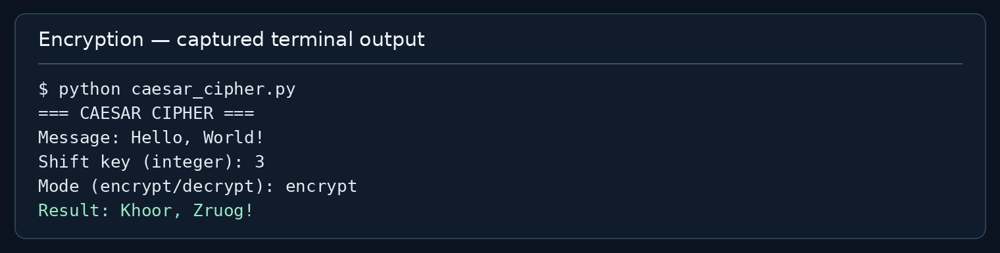
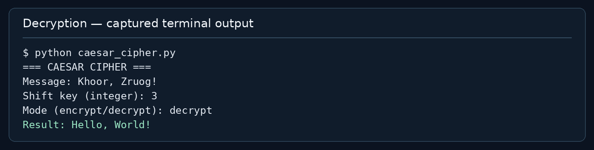
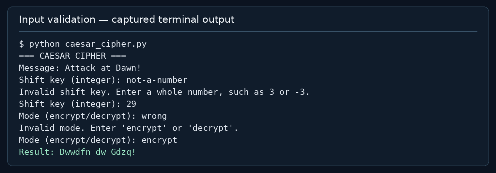
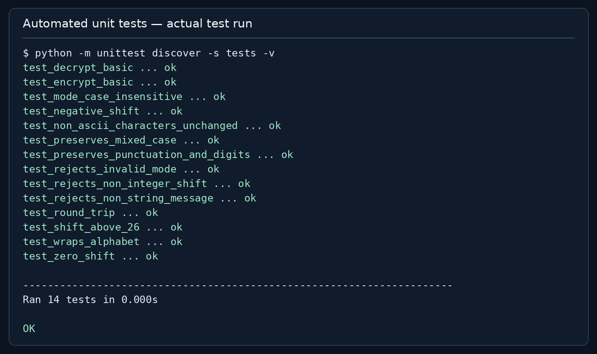

# Caesar Cipher — Python Encryption & Decryption

I developed a **Python Caesar cipher program** that encrypts and decrypts text by shifting letters through the alphabet. The project demonstrates character encoding, substitution-cipher logic, input handling, and automated testing.

The updated implementation supports **uppercase and lowercase text, wraparound, negative and large shift values, and input validation**. Spaces, punctuation, digits, and non-ASCII characters remain unchanged.

## Project Results

| Function | Test input | Output |
| --- | --- | --- |
| Encrypt | `Hello, World!` with shift `3` | `Khoor, Zruog!` |
| Decrypt | `Khoor, Zruog!` with shift `3` | `Hello, World!` |
| Wraparound | `XYZ xyz` with shift `3` | `ABC abc` |
| Large shift | `HELLO` with shift `29` | `KHOOR` |
| Mixed case | `Attack at Dawn!` with shift `5` | `Fyyfhp fy Ifbs!` |

**Automated validation:** All **14 unit tests passed** in the included test run. Tests cover encryption, decryption, case preservation, alphabet wraparound, punctuation, large/negative shifts, round-trip conversion, and invalid inputs.

## Encryption and Decryption Evidence

**Encryption — shift 3**



**Decryption — shift 3**



## Implementation

- **Python:** Built the encryption/decryption logic using character codes and modular arithmetic.
- **Shift normalization:** Uses `% 26` to handle large and negative integer keys consistently.
- **Case preservation:** Processes uppercase and lowercase ASCII letters independently.
- **Input handling:** Rejects unsupported modes and reprompts for non-integer shift keys.
- **Testing:** Uses Python's built-in `unittest` framework to check expected behavior.

### Input Validation



### Automated Test Results



## Code and Documentation

- [`caesar_cipher.py`](caesar_cipher.py) — updated Python implementation.
- [`Caesar Cipher.py`](Caesar%20Cipher.py) — initial implementation retained in the repository.
- [`tests/test_caesar_cipher.py`](tests/test_caesar_cipher.py) — automated unit tests.
- [`Caesar-Cipher-Case-Study.md`](Caesar-Cipher-Case-Study.md) — implementation details and results.
- [`reports/01-caesar-cipher-case-study.pdf`](reports/01-caesar-cipher-case-study.pdf) — technical project report.
- [`evidence/`](evidence/) — captured terminal output and test evidence.

## Run the Program

```bash
python caesar_cipher.py
```

Run the automated tests:

```bash
python -m unittest discover -s tests -v
```

## Cryptography Context

The Caesar cipher is a **classical substitution cipher** intended here for programming and cryptography education. It is easily broken and **must not be used to protect sensitive information**. The project demonstrates cipher mechanics, not production-grade encryption.
